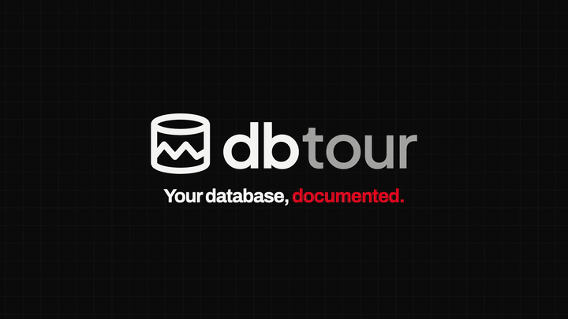
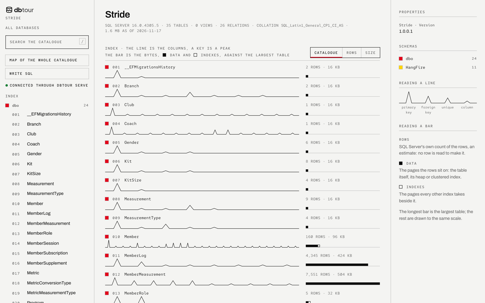
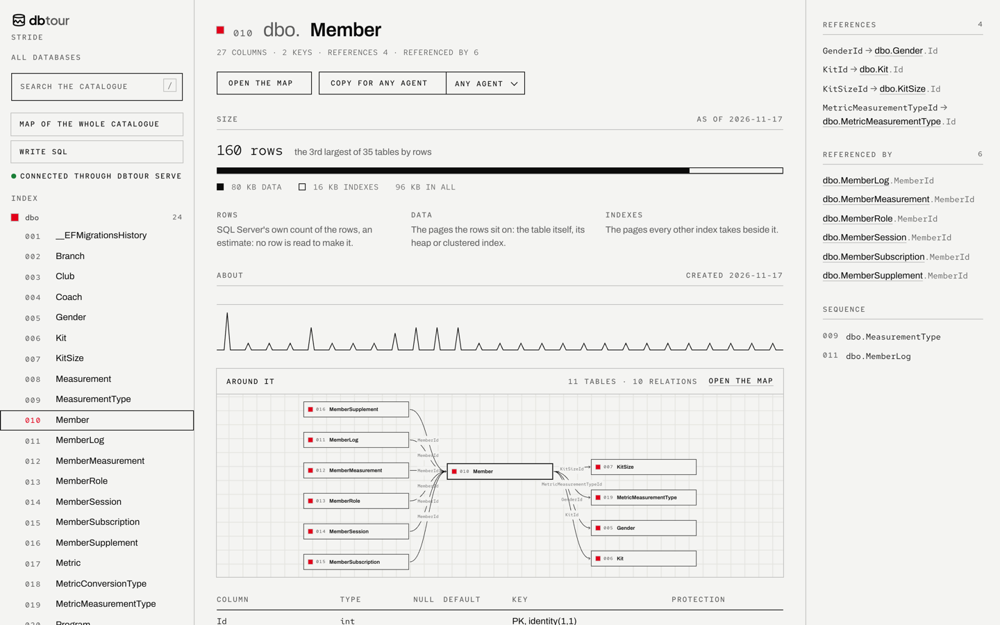
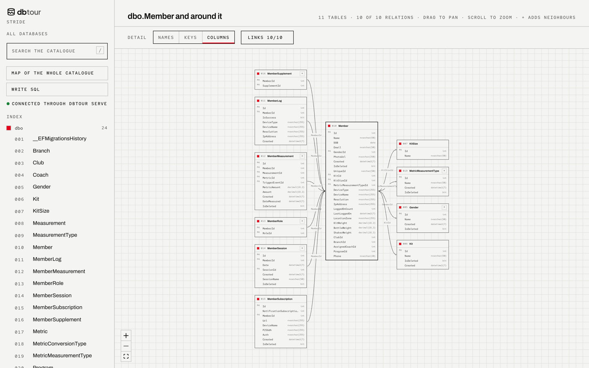
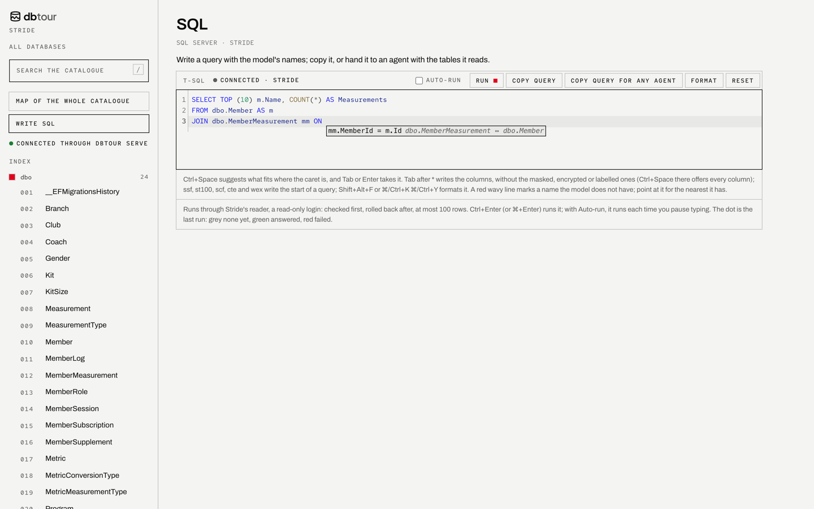

<div align="center">


**Schema docs for your database, kept in your repository, for people and agents.**

[](CHANGELOG.md)
[](https://github.com/victorsaly/dbtour/actions/workflows/check.yml)
[](https://www.npmjs.com/package/dbtour)

<a href="https://skills.victorsaly.com/dbtour#teaser"></a>

**[Watch it in 30 seconds](https://skills.victorsaly.com/dbtour#teaser)**, what it does with no setup, or
**[the whole tour](https://skills.victorsaly.com/dbtour#film)** in a minute and a half, with sound: the setup,
the catalogue, a table's page, the map, queries, and your agent asking over MCP, against a real SQL Server.

Or **[try the live example](https://skills.victorsaly.com/dbtour/example)**: the page itself, rendered from
[`examples/shop`](examples/shop), a made-up shop of six tables. Nothing to install.

</div>

dbtour reads a database, writes what it finds to one model file in your repository, and renders that file as
Markdown GitHub shows with diagrams, and as a page developers search, follow relations in and hand to an agent.

It reads the catalogue, never the rows, and an agent gets the same model through `dbtour mcp` and the
Claude Code plugin ([below](#ask-claude)). It works with SQL Server, Azure SQL and SQLite today; PostgreSQL
and MySQL follow the [plan](PLAN.md). Free and MIT licensed, for Claude Code, Codex, Cursor and any MCP client.

## The family

One model of your database, and six ways to use it. Each reads the same `schema.json`.

| | | What it is | Get it |
|---|---|---|---|
|  | **The app** | The page: set a database up, search the catalogue, read a table's entry, open the map, write and run read-only SQL. On your machine through `dbtour serve`, or one HTML file you deploy. | [one line](#start-in-one-line) |
|  | **The CLI** | `init`, `extract`, `render`, `sql`, `serve`, `mcp`: the model and its Markdown kept in your repository and checked in CI. | `npm i -D dbtour` |
|  | **The skill** | Teaches an agent when to reach for dbtour and to write SQL only from the names the model has. | `npx skills add victorsaly/dbtour -g` |
|  | **The MCP server** | The model a piece at a time for any MCP client: overview, search, table, the joins between two. | `claude mcp add dbtour -- npx dbtour mcp` |
|  | **The Claude Code plugin** | The skill and the MCP server in one install. | `/plugin marketplace add victorsaly/dbtour`, then `/plugin install dbtour@dbtour` |
|  | **The packages** | A source per database, the page, and the keychain, so you install only what you use. | [`dbtour-source-mssql`](https://www.npmjs.com/package/dbtour-source-mssql), [`dbtour-source-sqlite`](https://www.npmjs.com/package/dbtour-source-sqlite), [`dbtour-addon-explorer`](https://www.npmjs.com/package/dbtour-addon-explorer), [`dbtour-keychain`](https://www.npmjs.com/package/dbtour-keychain) |

### Each one, in and out

Every output below is what dbtour printed, run on [`examples/shop`](examples/shop) or a two-table SQLite file;
the skill's is an agent's reply from one of the [evals](evals), graded. `[…]` marks where an output is cut.

<details>
<summary><b>The app</b>: one line in, a page out</summary>

```bash
npx -y -p dbtour -p dbtour-source-mssql -p dbtour-source-sqlite -p dbtour-addon-explorer -p dbtour-keychain dbtour serve
```

```text
Serving the setup at http://127.0.0.1:4321
Nothing is set up yet: the page at http://127.0.0.1:4321/ walks you through it. Ctrl+C to stop.
```

The browser opens on the setup; five steps later, on the database's catalogue.
</details>

<details>
<summary><b>The CLI</b>: a model in, Markdown and a page out</summary>

```bash
cd examples/shop && npx dbtour render
```

```text
Wrote 8 files to docs.
```

`docs/tables/dbo.Orders.md`, one of them:

```markdown
# dbo.Orders

One row per checkout. The lines are in dbo.OrderLines.

About 312,904 rows · 29 MB of data · 9.3 MB of indexes, as the database counted them on 2026-11-01.

| Column | Type | Nullable | Default | Key | Description |
|---|---|---|---|---|---|
| Id | int | no |  | PK, identity |  |
| CustomerId | int | no |  | FK → [dbo.Customers](dbo.Customers.md).Id |  |
| Status | tinyint | no | `((0))` |  | 0 draft, 1 paid, 2 shipped, 9 cancelled |
```
</details>

<details>
<summary><b>The skill</b>: a question in, a plan from the real names out</summary>

Asked, with dbtour set up and its MCP server connected:

> Write me a SQL Server query for each customer's total of paid orders this year, largest first. Don't run
> anything: tell me how you'll find the tables and columns, then the query.

The agent, with the skill (`sql-reads-first`; graded *reads the tables first*: pass):

> I'm not going to fill the query in with likely-sounding names like `dbo.Orders` or `Total`. A guessed name
> can look right and still sum the wrong column. […]
> 1. **`overview`**: lists the databases and their tables, largest first. […]
> 2. **`search`** for `order`, `customer`, `paid` / `payment` / `status`, and `total` / `amount`. […]
> 3. **`table`** on each table I'll use […] If it's a status code, I'll look at the descriptions or
>    `dbtour.notes.yaml` for which value means paid. If nothing says, I'll ask you rather than guess.
> 4. **`path`** between orders and customers if they aren't directly related, to get the JOIN.
</details>

<details>
<summary><b>The MCP server</b>: a tool call in, the joins out</summary>

```json
{"jsonrpc":"2.0","id":3,"method":"tools/call","params":{"name":"path","arguments":{"from":"dbo.OrderLines","to":"dbo.Customers"}}}
```

````text
dbo.OrderLines to dbo.Customers: 2 joins.

```sql
FROM [dbo].[OrderLines]
JOIN [dbo].[Orders] ON [dbo].[Orders].[Id] = [dbo].[OrderLines].[OrderId]
JOIN [dbo].[Customers] ON [dbo].[Customers].[Id] = [dbo].[Orders].[CustomerId]
```

Each JOIN follows a relation as the docs record it; read the tables to choose the columns and whether a LEFT JOIN suits.
````
</details>

<details>
<summary><b>The Claude Code plugin</b>: two commands in, the skill and the server out</summary>

```text
/plugin marketplace add victorsaly/dbtour
/plugin install dbtour@dbtour
```

It adds the `dbtour` skill and the `dbtour` MCP server (`npx -y dbtour mcp`), with the tools `overview`,
`search`, `table` and `path`, and `query` when a source has a reader. Its `search` tool, given `customer email`,
answers from the model:

```text
- column dbo.Customers.Email: Login address.
```
</details>

<details>
<summary><b>The packages</b>: a SQLite file in, a model and a read-only query out</summary>

```yaml
# dbtour.yaml, beside notes.db
out: docs
sources:
  - type: sqlite
    name: Notes
    file: notes.db
    reader: read-only
```

```text
$ npx dbtour extract
Notes: 2 tables, 1 relations
Wrote docs/schema.json. Run dbtour render to write the docs.

$ npx dbtour sql "SELECT a.name, COUNT(*) AS notes FROM notes n JOIN authors a ON a.id = n.author_id GROUP BY a.name"
| name | notes |
|---|---|
| Ada | 2 |
| Lin | 1 |

2 rows.

$ npx dbtour sql "DELETE FROM notes"
The query starts with DELETE: dbtour runs only a SELECT, or a WITH followed by a SELECT.
```

The last exits 1: the reader is read-only, and dbtour checks the query before it reaches the file.
</details>

## Start in one line

To look at a database on your own machine, with nothing installed and nothing to learn first:

```bash
npx -y -p dbtour -p dbtour-source-mssql -p dbtour-source-sqlite -p dbtour-addon-explorer -p dbtour-keychain dbtour serve
```

Your browser opens on a page that sets the database up in five steps: where it is, how dbtour signs in (Entra
through `az`, or a login whose password goes to the system's keychain), a test, a read-only login for queries
if you want one, and the read. A SQLite file takes the same steps with less in them: its path, no sign-in, a
test, a yes to queries (each opens the file read-only), and the read. Then its page opens. Run the same line again to come back to it, or to add
another. [Your databases, without a project](#your-databases-without-a-project) says what it keeps where.

## Use it in a project

```bash
npm install --save-dev dbtour dbtour-source-mssql dbtour-addon-explorer
npx dbtour init                                  # writes dbtour.yaml
export DBTOUR_MSSQL='Server=localhost,1433;Database=Shop;User Id=reader;Password=…;TrustServerCertificate=True'
npx dbtour extract                               # → docs/dbtour/schema.json
npx dbtour render                                # → docs/dbtour/README.md, one page per table, index.html
```

The SQL Server source reads the catalogue and nothing else: a login with `VIEW DEFINITION` on the database is
enough. Each table's rows and bytes come from the catalogue too, as SQL Server counts them, without reading a
row. So does everything else the database keeps about its objects: every extended property, under any name;
whether a table is temporal, memory-optimised, a ledger, partitioned or compressed, its triggers, change
tracking, change data capture and row-level security; a column's collation, identity seed, masking and
Always Encrypted; index kinds and filters, and keys no longer trusted. Sensitivity labels want `VIEW ANY
SENSITIVITY CLASSIFICATION` as well; without it, `extract` says they were not read. Features an older
SQL Server lacks are simply absent.

`dbtour.yaml`:

```yaml
out: docs/dbtour
sources:
  - type: mssql
    name: Shop
    connection: ${DBTOUR_MSSQL}   # the name of an environment variable, never the string itself
    exclude: [dbo.sys*, "*.webpages_*"]   # optional: tables to leave out
    reader: ${DBTOUR_MSSQL_READER}        # optional: a read-only login of its own, for dbtour sql
notes: dbtour.notes.yaml          # optional
addons:
  - explorer                      # the page; leave out for Markdown only
```

A SQLite file needs no server, no login and no driver: the source uses the SQLite Node ships.

```bash
npm install --save-dev dbtour dbtour-source-sqlite dbtour-addon-explorer
```

```yaml
sources:
  - type: sqlite
    name: Shop
    file: shop.db                 # from the folder dbtour.yaml is in; a path is no secret
    reader: read-only             # optional: dbtour sql and the page run queries, the file opened read-only
```

It reads what SQLite keeps: tables, views, keys, relations, indexes, CHECKs, generated columns, collations,
triggers, and each table's rows and bytes from the file's pages. SQLite keeps no descriptions, but it keeps
each `CREATE TABLE` as written, so a comment there is one: on a column's line, or the line before it, it
describes the column; on the line of the opening bracket, the table.

Several sources document several databases. With more than one, each table is named with its database,
`Sales:dbo.Customers`, so two databases that both have a `dbo.Customers` keep them apart: in the Markdown
(`tables/Sales/dbo.Customers.md`), on the page (`#Sales:dbo.Customers`) and to an agent. The notes may
leave the database out wherever only one database has the table, and are told when it is needed. A source's
`name` is how its database is named, so each needs its own, without a dot, a colon or a slash.

## The page

`docs/dbtour/index.html` is one file with the model inlined: open it from disk, or deploy the folder as it is.
It holds the structure and never the rows.

| | |
|---|---|
|  |  |
| **The catalogue**: every table, its keys and its size | **An entry**: what a table holds, how big, what it links to |
|  |  |
| **The map**: a table and its neighbours, drawn large | **Write SQL**: autocomplete that knows the joins |

- `/` searches tables, columns and groups; arrows and Enter open a result.
- A table shows its columns with type, nullability, default, keys and description, the relations in and out
  as links, and its indexes and constraints below.
- Every entry carries a small map of the table and its neighbours; **Open the map** draws it large, laid out
  by ELK. **+** on any node adds that table's neighbours, and back takes them away. **Map of the whole
  catalogue** draws everything. Three levels of detail, Names, Keys and Columns, keep wide tables readable,
  and the **Links** panel switches any relation off, by itself or as a group. A group from the notes is a
  map of its tables.
- Every view has a URL: `#dbo.Orders`, `#dbo.Orders.Status`, `#diagram/dbo.Orders,dbo.Customers`,
  `#group/Billing`, `#map`.
- **Copy for …** puts the table's Markdown on the clipboard for whichever agent you use, Claude, ChatGPT,
  Gemini, Copilot, Cursor or any other; the choice is remembered, and tools with a web chat get an Open link.
- Every table has a number and every schema a colour, and each table is drawn as one line: a pulse per
  column, a key as a peak. Dark mode follows the system.
- Sizes, when the source read them: a bar beside each line of the index shows the table's bytes against
  the largest, split into data and indexes, with its rows written over it; the index can be read by
  **Rows** or **Size**, largest first, as well as in catalogue order; and an entry opens on its size, its
  place among the tables, and what each figure means.
- What the catalogue says: an entry's **About** block puts each feature of the table in a plain sentence
  (system-versioned, partitioned, triggers and the rest), with when it was created and its properties; a
  **Protection** column shows a column's sensitivity label, mask and encryption; triggers and row-level
  security are sections of their own, like indexes and constraints.
- A **Query** section on every entry starts a query from the table and what it references, in an editor that
  autocompletes the database's tables and columns; **Write SQL** in the rail opens one for any query. Copy it,
  or copy it for an agent with the tables it reads. Opened through `dbtour serve`, it runs it too (below).

## Ask Claude

The dbtour skill teaches an agent when to reach for dbtour and how: set it up with the connection string kept
in an environment variable, find a table a piece at a time, and write SQL only from the names the model has.

```bash
npx skills add victorsaly/dbtour                 # Claude Code, Codex, Cursor and other agents that read Agent Skills
```

In Claude Code the plugin brings the skill and connects the MCP server below in one go:
`/plugin marketplace add victorsaly/dbtour`, then `/plugin install dbtour@dbtour`.

`dbtour mcp` serves the model to an agent over the [Model Context Protocol](https://modelcontextprotocol.io),
so Claude can find the table it needs, read it and join it, instead of being handed the whole schema:

```bash
claude mcp add dbtour -- npx dbtour mcp          # Claude Code, from the project's folder
```

For Claude Desktop or any other client, run `npx dbtour mcp /path/to/project`. It offers four read-only
tools:

- **overview**: the databases and their tables, largest first, with the groups from the notes.
- **search**: tables, views, columns and groups by any part of their name, type or description, the same
  search as the page.
- **table**: one table as the Markdown in `docs/dbtour/tables/`: columns, keys, relations both ways,
  indexes, constraints.
- **path**: the shortest chain of relations between two tables, written as the JOINs that follow them.

It reads `schema.json` and the notes, and reads them again when they change. Like the page, it holds the
structure and never the rows, and it needs no connection string. What it answers goes to the model provider
your agent uses, so a schema that must not leave your network wants a model that stays inside it.

`dbtour.notes.yaml` adds what the database cannot say, and wins over it:

```yaml
tables:
  dbo.Orders:
    description: One row per checkout. Lines are in dbo.OrderLines.
    columns:
      Status: 0 draft, 1 paid, 2 shipped, 9 cancelled
relations:
  - from: dbo.AuditLog.OrderId     # a relation nobody declared as a foreign key
    to: dbo.Orders.Id
groups:
  - name: Billing
    tables: [dbo.Orders, dbo.OrderLines, dbo.Invoices]
```

## Run a query

With a `reader` on a source (a login with `db_datareader` alone, never the one `extract` uses), dbtour runs a
query too:

```bash
export DBTOUR_MSSQL_READER='Server=…;Database=Shop;User Id=dbtour_reader;Password=…'
npx dbtour sql "SELECT TOP (10) Id, Status FROM dbo.Orders ORDER BY Id DESC"
```

and `dbtour mcp` offers a **query** tool beside the others, so an agent can check what it wrote. Either way it
runs one SELECT, or WITH … SELECT: anything that writes, runs code or reaches out of the database is refused
before a connection is made, and what runs does so inside a transaction that is always rolled back, at most
100 rows (`--limit` up to 5,000), 10 MB and 30 seconds. The rows are shown, never written into the model.
Through the MCP server they go to the model provider your agent uses. What dbtour checks is the query's shape;
what a name can reach (another database, a linked server) is the reader's permissions, so keep the reader to
this database alone.

A SQLite source has no logins, so its reader is `reader: read-only`: each query runs in a process of its own
with the file opened read-only, where SQLite refuses any write, and the process is killed at 30 seconds.

On the page, `dbtour serve` runs it the same way:

```bash
npx dbtour serve                                 # http://127.0.0.1:4321, on this machine only
```

The editor's bar says it is connected, and Run (or ⌘/Ctrl+Enter) shows the rows under the query, with how
many, how long it took and through which reader. The dot beside it is the last run: grey before one, green
answered, red failed, with why. Auto-run, off until you tick it, runs the query each time you pause typing,
and never a half-written one. The server answers only its own page, which carries a token it is given when
served, and only on this machine.

## Your databases, without a project

The one line above serves a home of the databases set up on your machine, each with its page, and the setup of
another. Settings go to `~/.dbtour` (`DBTOUR_HOME` elsewhere) with no secret in them, a folder per database
holds its model and its page, and passwords go to the system's keychain (macOS Keychain, Windows Credential
Manager, the Secret Service on Linux), never to a file. Nothing is saved until the database answers, and the
read-only login is made only once you have read its two statements and pressed the button that runs them.

The same from a terminal, for an agent or a script:

```bash
npm install -g dbtour dbtour-source-mssql dbtour-addon-explorer dbtour-keychain
dbtour add Shop --server shop-sql.database.windows.net   # signs in with az; tested before it is saved
dbtour reader Shop --create                              # shows what it would run; --confirm Shop runs it
dbtour read Shop                                         # its model and its page
dbtour serve                                             # the home, at http://127.0.0.1:4321
```

A SQLite file is `dbtour add notes --file ~/data/notes.db`, tested by opening it read-only, then `dbtour reader
notes --read-only` to let queries read it: no password, so no keychain. A login signs in with `--sign-in login --user <login> --password-stdin`: the password comes only on stdin, and
`--password` is refused, as a command line ends up in shell history and an agent's log. `dbtour reader --create`
makes `dbtour_reader` with `db_datareader` alone and a password nobody sees, once you confirm by naming the
database again. With several databases set up, `sql`, `mcp` and `serve --database` must name one; dbtour never
picks for you. `dbtour list` shows them, and `dbtour remove` forgets one and its passwords. The home lists each
database with a green dot when it has a reader, and each database's page has the others in its rail.

## Roadmap

The detail and the order are in [PLAN.md](PLAN.md).

- **Released**: SQL Server and Azure SQL; SQLite; the page with search, entries, the map and SQL; the MCP
  server, the skill and the Claude Code plugin; setup on the page with passwords in the keychain.
- **Next**: PostgreSQL.
- **Planned**: MySQL, and schemas from tbls or pasted in; OpenAPI, linking each endpoint to the tables it reads;
  a deploy workflow and `dbtour check` for CI; index and table usage on each entry; descriptions an agent
  suggests, kept for your review; lookup values you choose to keep, shown beside their codes.

## Develop

```bash
npm install
npm run check      # lint, typecheck, tests with coverage (builds the page first)
npm run example    # renders examples/shop into examples/shop/docs; open examples/shop/docs/index.html
npm run e2e:page   # drives the page in Google Chrome
npm run brand      # redraws brand/ from the mark in packages/addon-explorer/src/mark.ts
```

## Licence

MIT
